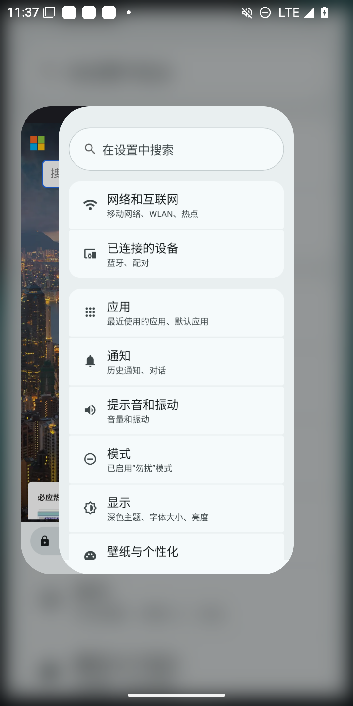
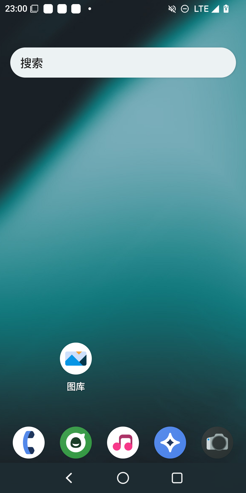
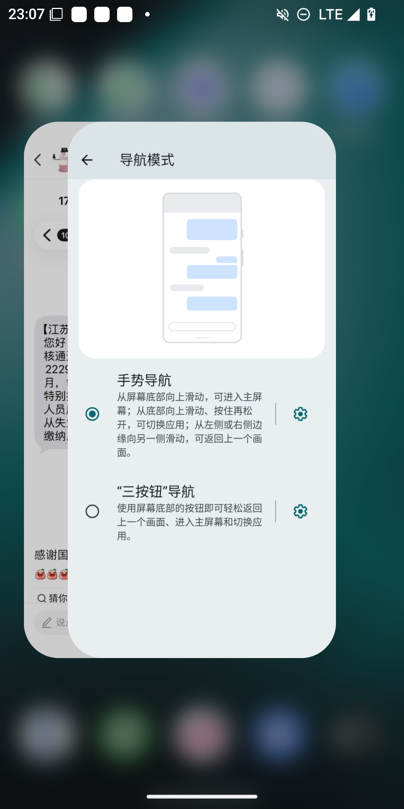
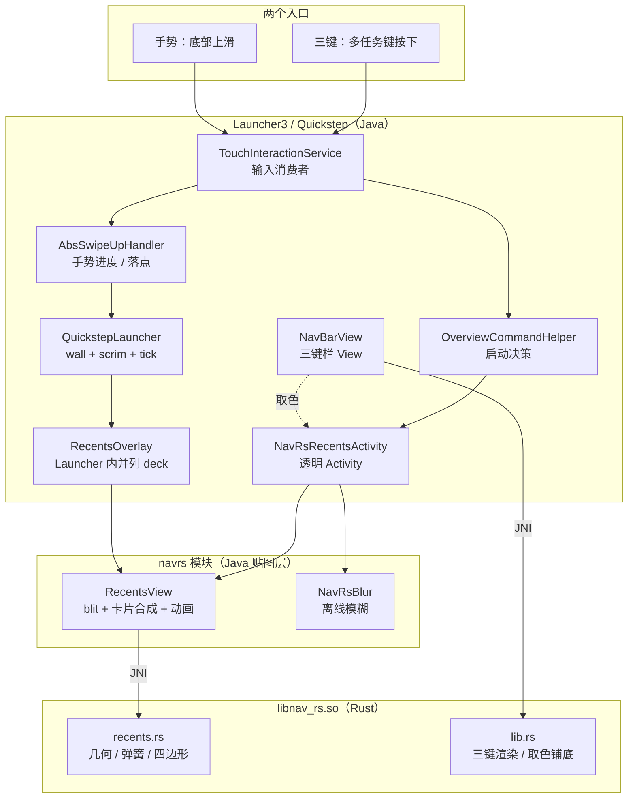

# NavRS · 纯自研第三方堆叠式最近任务（Rust + AOSP Launcher3）

> 一套从零重写的 Android「最近任务 / 多任务后台」，彻底替换 AOSP / LineageOS Quickstep 的
> overview，卡片以**堆叠**形态呈现；底部三键导航栏也由同一套 Rust 渲染器绘制。
> 这不是 Xposed 模块、不是主题、不是 Launcher 插件 —— 它是直接改在 `Launcher3` 源码树里的
> 一套独立实现。



> **项目状态：主体功能已全部完工，但作者精力有限，本项目暂停维护（unmaintained）。**
> 代码、文档、刷机包全部公开，欢迎 fork / 移植 / 继续开发；作者不再保证 issue 响应与后续更新。

---

## 目录

- [它是什么](#它是什么)
- [功能一览](#功能一览)
- [截图](#截图)
- [架构一眼](#架构一眼)
- [仓库结构](#仓库结构)
- [文档索引](#文档索引)
- [刷机包（ROM）](#刷机包rom)
- [已知限制](#已知限制)
- [License](#license)

---

## 它是什么

Android 的「最近任务」在 AOSP 里由 Quickstep（`Launcher3` 的一部分）实现：手势上滑时由
Shell 的 `RecentsAnimation` 把前台 app 缩成卡片，再由 Launcher 的 `RecentsView` 摆成横向列表。

本项目把这一整层**换掉**：

| 环节 | AOSP Quickstep | NavRS |
| --- | --- | --- |
| 卡片几何 | `RecentsView` + `TaskView` + `GridLayout` | **Rust**（`nav-rs/src/recents.rs`）逐帧计算，`nativeCardQuad()` 输出 |
| 卡片绘制 | 每个 TaskView 一个 Surface / 硬件层 | Java 侧把缩略图按 Rust 给出的四边形合成到一张 View 上 |
| 背景 | 壁纸 + 系统 scrim | 桌面截图 + **预烘焙模糊** + scrim，三层交叉淡入 |
| 三键栏 | SystemUI / Taskbar 原生按钮 | **Rust** 绘制（`lib.rs`），Java 只负责取色与事件转发 |
| 进入后台 | Shell 动画 + Launcher overview | 三键：独立透明 Activity；手势：Launcher 内并列 deck，接管 Shell 的 live tile |

一句话：**几何、动画曲线、弹簧、按键渲染都在 Rust 里，Java 只做「贴图 + 事件 + 生命周期」。**

## 功能一览

### 堆叠后台（deck）

- **堆叠 / 卡片队列**：前卡居中，后卡按固定 pitch 向上偏移并等比缩小，形成层叠；左右滑动翻页。
- **弹簧物理**：位置用 stiffness / damping 弹簧收敛（`STIFFNESS=140`、`DAMPING=0.86`），
  快速滑动带速度惯性，越界有 rubber-band 阻尼。
- **两种卡片尺寸**：紧凑（`CARD_H_SMALL=0.663`）/ 大卡（`CARD_H_LARGE=0.85`），长按三键可切。
- **亮度层级**：后卡按 `DECK_DIM=0.80` 压暗，前卡滑走时按 `DECK_BRIGHT_TRIGGER=0.25` 逐级点亮。
- **点按进入**：点前卡 → 卡片放大到全屏 → 启动对应 task（`startLaunch` + `ActivityOptions` 无系统动画）。
- **上滑销毁**：前卡上滑超过阈值 → 卡片上移淡出 → `removeTask()`（带阈值与回弹）。
- **上滑关闭后台**：在底部手势区上滑 → 整个 deck 向左滑出 + 背景溶回桌面（`SLIDE_OUT_MS=280`）。
- **点空白关闭**：点背景（非卡片）→ 关闭后台。
- **进入动画**：
  - 从 **app** 进入：前卡从全屏「缩回」到堆叠位（`startReturn`，320/480ms 可调）。
  - 从 **桌面** 进入：卡片从左侧滑入（`startSlideInFromLeft`，`SLIDE_IN_MS=420`）。
- **手势接管**：手势上滑过程中，deck 与 Shell 的 live tile 同步（`setDragProgress`），
  松手后用 `settleDragReturn()` 从 Shell 的最后一帧矩形 **平滑交接**（`HANDOFF_MS=220`），不跳变。

### 背景

- 背景是**桌面截图**（不是壁纸），所以模糊后连图标、widget 一起虚化。
- 模糊**一次性烘焙**（`NavRsBlur`：降采样 + 三次 box blur + 放大），运行期零 RenderEffect 开销。
- 三层结构：`sharp`（清晰桌面）/ `blur`（预模糊）/ `scrim`（`#66000000`）。
  - app 路径：直接显示 blur + scrim。
  - 桌面路径：sharp 起步，随卡片滑入交叉淡入到 blur（视觉等价于「模糊半径动画」，但每帧零成本）。
- 退出时 blur/scrim 同步淡出，露出真实桌面。

### 三键导航栏（Rust 绘制）



- 三个按键（返回 / 桌面 / 多任务）由 `lib.rs` 直接画进一块 ARGB buffer，Java 只 blit。
- 按钮收进屏幕中间 **66%**（`BTN_BAR_FRACTION=0.66`），比原生三等分更聚拢，误触面积更小。
- **按键颜色自适应**：底栏按背景取色（桌面取壁纸底部 1/8、水平中间 60% 的平均色；
  app 内取 app 截图导航栏上方一带的平均色），再按亮度选深/浅按键。
- **锁屏联动**：`nativeSetKeyguard` 切换锁屏图标形态。
- **长按多任务**：打开调参面板（`RecentsTuningPanel`），可切卡片尺寸/弹簧/过渡速度。
- 原生按钮容器 `mNavButtonContainer` 被 `alpha=0` 隐藏，事件仍走
  `TaskbarNavButtonController`（保留预测性返回、长按截屏等系统行为）。

### 状态栏

- 进入后台时**不再让顶栏内容先渐隐**：新窗口打开时先按「当前 app 顶栏的亮度」声明
  状态栏图标深浅（`WindowManager.LayoutParams.appearance`），等前卡滑出状态栏区域后
  再按背景亮度重设一次。
- 背景顶部亮度由 `topBandLuma()` 采样，深色背景 → 白色图标，浅色背景 → 深色图标。

### 性能相关（相对第一版）

- 桌面截图在 **工作线程** 采集（`captureDisplay` 是同步全屏回读，原先会卡主线程 30–120ms）。
- 桌面截图与预模糊结果**静态缓存**（`sNavRsDesktopShot` / `sNavRsDesktopBlur`），后台直接复用。
- 壁纸解码/模糊移到工作线程（仅在无截图缓存时兜底）。
- Shell live tile → deck 的交接用固定 220ms 缓动，避免「先空一帧再落位」。
- 后台里上滑不再创建 `OtherActivityInputConsumer`（否则会把整个后台缩成卡片）。

## 截图

| 堆叠卡片 | 背景（模糊桌面 + scrim） | 三键栏（桌面） |
| --- | --- | --- |
|  |  |  |

## 架构一眼



更完整的时序图、状态机与数据流见 **[docs/ARCHITECTURE.md](docs/ARCHITECTURE.md)**。

## 仓库结构

```
navrs-stacked-recents/
├── README.md
├── CHANGELOG.md                 # 按批次记录的改动（batch1..batch15）
├── LICENSE / NOTICE             # Apache-2.0 + AOSP 归属声明
├── docs/
│   ├── ARCHITECTURE.md          # 架构、时序图、状态机、数据流
│   ├── INTERFACES.md            # JNI / Java facade / 设置项 / 常量 / 日志探针
│   ├── PORTING.md               # 移植到其它机型 / ROM 的完整步骤
│   ├── BUILD.md                 # 编译、部署、验证
│   ├── ROM.md                   # 刷机包说明与校验
│   ├── HANDOVER.md              # 现场笔记（踩坑记录，12 节）
│   └── DESIGN-NOTES.md          # 早期设计文档（43KB，含布局推导）
├── java/
│   ├── navrs/                   # 独立 android_library 模块（com.wzy.navrs）
│   ├── quickstep/               # com.android.launcher3.navrs（对 quickstep 暴露的 facade）
│   └── framework/               # 被改动的 7 个 AOSP 文件（原样，便于 diff 移植）
├── rust/
│   ├── Cargo.toml / Cargo.lock
│   └── src/{lib.rs, recents.rs, deck.rs}
└── tools/                       # 构建 / 部署 / 补丁脚本
```

## 文档索引

| 文档 | 内容 |
| --- | --- |
| [docs/ARCHITECTURE.md](docs/ARCHITECTURE.md) | 分层、两条进入路径时序、deck 状态机、背景/取色数据流、类职责表 |
| [docs/INTERFACES.md](docs/INTERFACES.md) | 33 个 JNI 函数、`NavRsActivity` facade、`NavRsBridge.Host`、Intent extra、`settings` 键、常量表 |
| [docs/PORTING.md](docs/PORTING.md) | 从零移植到另一台机器：模块放置、7 处框架 hook、Rust 交叉编译、dexpreopt、SELinux、导航模式切换 |
| [docs/BUILD.md](docs/BUILD.md) | 编译命令、部署顺序、`MSYS_NO_PATHCONV` 坑、验证清单 |
| [docs/ROM.md](docs/ROM.md) | 整包构建、预编译 launcher 包、校验和、刷入方法 |
| [docs/RESTORE.md](docs/RESTORE.md) | 换一台电脑如何从本仓库还原（仓库有什么 / 缺什么 / 怎么补） |
| [docs/HANDOVER.md](docs/HANDOVER.md) | 开发现场笔记：坐标、坑、日志判读 |
| [docs/DESIGN-NOTES.md](docs/DESIGN-NOTES.md) | 早期设计长文：布局推导、六种布局尝试、为什么收敛到堆叠 |

## 预编译包（Release）

`v1.0.0` 的附件是**已在真机验证过**的 launcher 增量包（不是整包）：

| 附件 | 大小 | 内容 |
| --- | --- | --- |
| `navrs-launcher-20261115.zip` | 15.0 MB | `Launcher3QuickStep.apk` + `.odex` + `.vdex` + `libnav_rs.so` + 安装/回滚说明 |

装法（`adb root` 后 push 四个文件 + `restorecon` + 切三键）见包内 `README.txt` 或
[docs/ROM.md](docs/ROM.md) 第 5 节。

**整包**（`m bacon`）需要 ≥32GB 内存的机器：本项目开发机（宿主 15.8GB / WSL 12GB）在
soong 全量分析阶段就会换页卡死，所以仓库不附带整包，只有构建脚本与校验流程
（[docs/ROM.md](docs/ROM.md)）。

## 已知限制

- **只在 Xiaomi Mi MIX 2S（polaris）/ LineageOS 22.2 / Android 15 上验证过**，其它机型需要按
  [PORTING.md](docs/PORTING.md) 重新编译（Rust 侧与 Java 侧都不含机型相关常量，但
  `navrs` 模块依赖 `Launcher3QuickStepLib`，必须跟 ROM 一起编译，不能单独装 APK）。
- 只保留 **堆叠（gear deck）** 一种布局；早期尝试过的六种布局已移除（见 `DESIGN-NOTES.md`）。
- 三键模式是主要目标形态；手势模式下用「Launcher 内并列 deck + Shell live tile」的方案，
  在低端机上仍有掉帧（见 `HANDOVER.md` 的性能笔记）。
- 依赖 AOSP 私有 API（`IWindowManager.captureDisplay`、`ScreenCapture`、`RecentsModel` 等），
  **不能**作为普通 APK 安装。
- 无自动化测试；验证方式是 `adb logcat` 探针 + `screenrecord` 抽帧（方法见 `BUILD.md`）。

## License

Apache License 2.0。本项目包含/修改了 AOSP `Launcher3` 的源码（Apache-2.0），
原始版权归 The Android Open Source Project 所有，详见 [NOTICE](NOTICE)。
