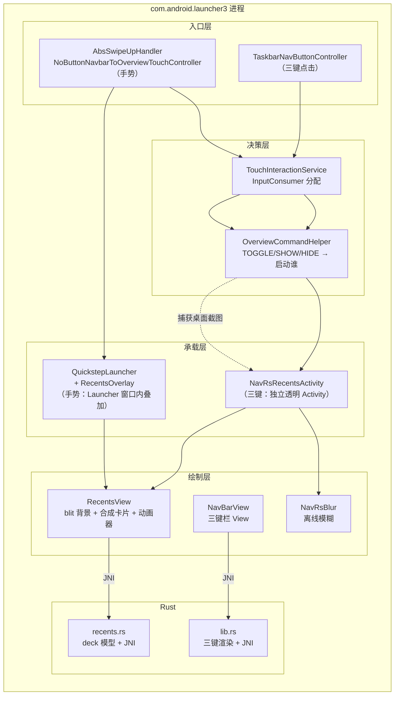
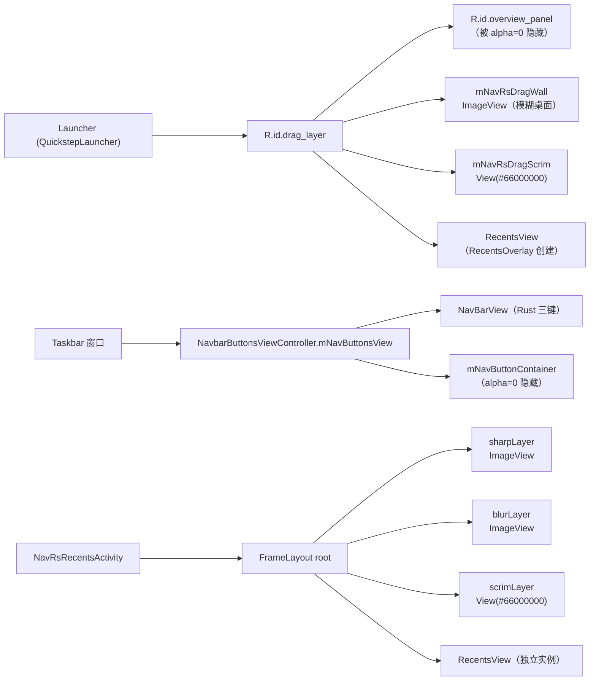
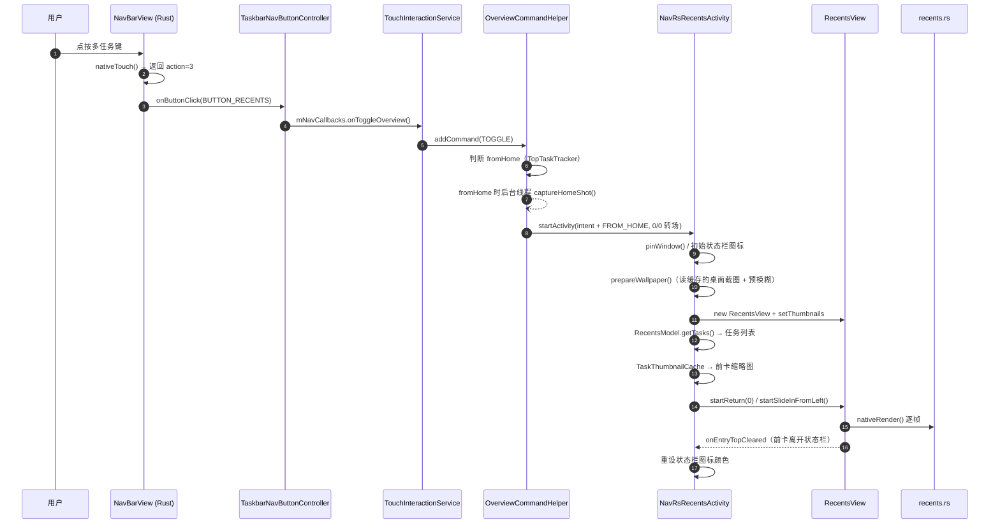
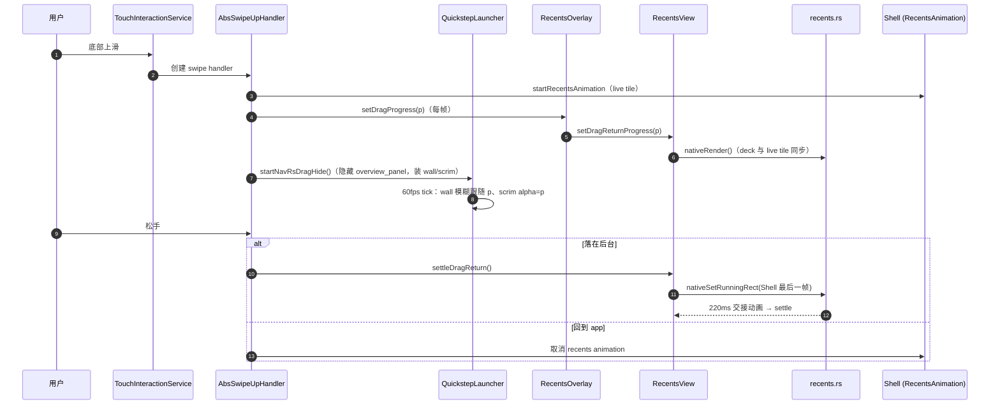
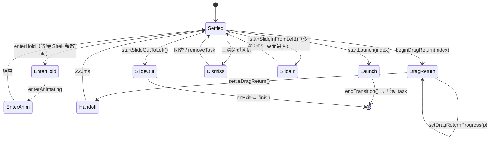
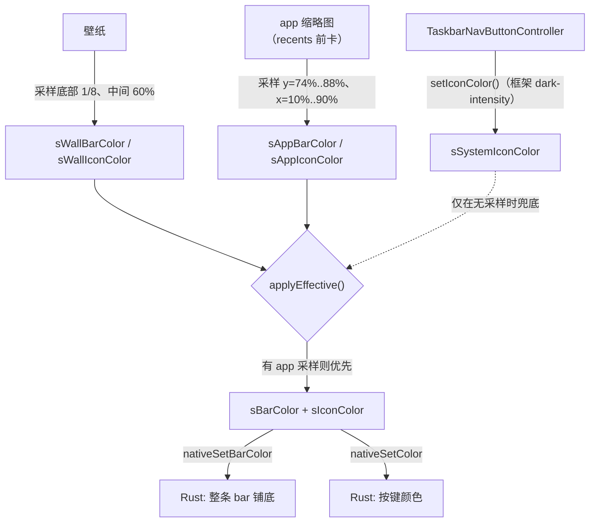

# 架构

> 读者对象：想接手维护、或者把这套后台移植到自己 ROM 的人。
> 现场踩坑记录见 [HANDOVER.md](HANDOVER.md)，早期布局推导见 [DESIGN-NOTES.md](DESIGN-NOTES.md)。

## 1. 设计目标

1. **完全替换** AOSP Quickstep overview，而不是在上面叠皮肤。
2. 卡片几何 / 动画 / 弹簧 / 三键渲染都放在 **Rust** 里，Java 只做「贴图 + 事件 + 生命周期」。
3. 单进程：所有 Java 代码都跑在 `com.android.launcher3` 进程内，Rust 以 `cdylib` 形式 JNI 调用，
   没有跨进程通信、没有额外 Surface。
4. 手势与三键**两条入口共用同一套 deck**（同一份 `RecentsView` 实现、同一份 Rust 模型）。

非目标：多窗口 / 分屏任务列表、自由窗口缩略图、桌面模式（tablet）、多用户。

## 2. 进程与分层



要点：

- **`navrs` 是一个独立 `android_library`**（`java/navrs/Android.bp`），依赖 `Launcher3QuickStepLib`，
  这样改动画代码不会重编整个 launcher 库。
- `quickstep` 模块**看不到** `com.wzy.navrs.*`（`navrs` 依赖它，反向不成立），
  所以 quickstep 侧只使用 `com.android.launcher3.navrs.*` 这一层 facade。
- Rust 侧两个 JNI 名字空间：`Java_com_wzy_navrs_NavBarView_*`（三键）与
  `Java_com_wzy_navrs_RecentsView_*`（deck）。

## 3. 组件树



## 4. 入口 A：三键「多任务」



关键点：

- **没有走 Shell 的 recents 动画**：`OverviewCommandHelper` 直接用
  `ActivityOptions.makeCustomTaskAnimation(0,0)` 启动我们自己的 Activity，
  所以不会出现「原生 overview 先闪一下再被替换」。
- Activity 窗口是**透明**的：在缩略图就绪前，app 仍然可见；`startEntry()` 一次性把
  背景、卡片、前卡全屏帧一起显示，避免中途露白。
- `ENTRY_FALLBACK_MS=700`：前卡缩略图迟迟不来时兜底开演，避免一直停在透明窗口。

## 5. 入口 B：手势上滑



要点：

- 手势路径**不经过** `NavRsRecentsActivity`，deck 是 launcher 窗口里的一个 View
  （`RecentsOverlay.install()`），与 Shell 的 live tile 叠加。
- `AbsSwipeUpHandler.calculateEndTarget()` 里对 `NavRsActivity.isOpen()/recentlyExited()`
  有特判：退出动画进行中要返回 `LAST_TASK`（取消手势）而不是 `HOME`，否则会二次进入后台。
- 落点 `HOME` 时 Shell 会播放「缩成图标飞回桌面」；activity 路径则返回 `LAST_TASK`
  （什么都不动画，因为我们的卡片已经自己播完了）。

## 6. deck 状态机

`RecentsView` 的绘制分支由几个互斥标记决定（`onDraw` 里的顺序即优先级）：



相关常量（`RecentsView.java`）：

| 常量 | 值 | 含义 |
| --- | --- | --- |
| `SLIDE_IN_MS` | 420 | 桌面进入时 deck 从左侧滑入 |
| `SLIDE_OUT_MS` | 280 | 上滑关闭时向左滑出 |
| `HANDOFF_MS` | 220 | Shell live tile → deck 的交接 |
| `LAUNCH_DURATION_SOFT` | 480 | 打开卡片（柔和） |
| `LAUNCH_DURATION_FAST` | 320 | 打开卡片（干脆） |
| `NEIGHBOUR_FRACTION` | 0.40 | 打开动画前 40% 用于清场邻卡 |
| `TAP_TIMEOUT_MS` | 350 | 空白处点按关闭的判定 |
| `ENTRY_FALLBACK_MS` | 700 | 前卡缩略图兜底超时 |
| `BLUR_MAX` | 52 | 背景模糊半径（烘焙时） |

## 7. 背景数据流

```mermaid
flowchart LR
    A["QuickstepLauncher<br/>captureNavRsDesktopShot()"] -->|工作线程 captureDisplay| B["sNavRsDesktopShot<br/>(Bitmap 1080x2160)"]
    B -->|NavRsBlur.blur(52f)| C["sNavRsDesktopBlur<br/>(120x240 ARGB)"]
    B --> D["sharpLayer"]
    C --> E["blurLayer"]
    F["scrimLayer #66000000"] --> G["合成"]
    D --> G
    E --> G
    G --> H["deck 下方"]
    B -->|topBandLuma| I["状态栏图标深浅"]
    C -->|topBandLuma| I
```

- 截图只在 **Launcher 真正持有焦点** 且状态是 `NORMAL` 时采（`scheduleNavRsDesktopShot(900,true)`），
  否则会把「刚起来的 app」当成桌面存下来 —— 这是历史 bug 之一。
- 模糊在 `NavRsBlur` 里做：按半径降采样（52px → 1/9），三次 box blur，画出时由 ImageView
  放大（`CENTER_CROP` + 双线性过滤）。等价于 52px 高斯，但**每帧零成本**。
- 桌面进入需要「清晰 → 模糊」的过程：不做半径动画，而是 sharp(α=1) 与 blur(α=0→1)
  交叉淡入 `SLIDE_IN_MS`，像素结果与半径动画几乎一致。

## 8. 三键栏数据流



- 颜色优先级：**app 采样 > 壁纸采样 > 框架按键色 > 深色兜底**。
- 回到桌面时 `NavBarView.clearAppBarColor()` 清掉 app 采样（`QuickstepLauncher.onStateSetEnd(NORMAL)`）。
- 三键栏住在 **Taskbar 窗口**里（3 键模式下 Taskbar 就是导航栏），
  由 `NavRsIntegration.install()` 挂到 `mNavButtonsView` 上，并把原生按钮容器 `alpha=0`。

## 9. 卡片几何协议（Java ↔ Rust）

Rust 是几何的唯一来源。每帧：

1. `nativeRender(handle, buffer, frameTimeNanos)` → 把背景（卡片阴影、圆角矩形底色）渲进
   `w×h` 的 RGBA buffer；返回 `true` 表示还在动，需要下一帧。
2. Java 把 buffer `copyPixelsFromBuffer` 进 `Bitmap` 并 `drawBitmap` 到全屏。
3. 每张卡：`nativeCardQuad(handle, i, out[6])` → `[left, top, right, bottom, corner, skew]`；
   `nativeCardAlpha(handle, i)` → 亮度。
4. Java 用 `clipPath(roundRect)` 裁切 + `ColorMatrix` 调亮度，把缩略图 `drawBitmap` 到该矩形。

坐标约定：**Rust 内部工作在缩放后的栅格空间**（`SCALE=0.32`），
`RecentsView` 负责换算（`nativePx()`），因此 Rust 不需要知道屏幕真实像素。

`skew` 用于透视/扇形布局（顶边与底边的水平偏移），当前堆叠布局恒为 0。

## 10. 线程模型

| 线程 | 做什么 |
| --- | --- |
| main（UI） | 所有 View、动画器、`nativeRender`、JNI 调用 |
| `NAVRS_SHOT_EXEC`（单线程） | 桌面截图 `captureDisplay` + 预模糊 + 对比度统计 |
| `EXEC`（单线程，Activity 内） | 壁纸解码/模糊、缩略图等比缩放（`windowAspectThumb`） |
| `navrs-app-colour` | app 截图底部带取色 |
| `navrs-bar-colour` | 壁纸底部带取色 |
| `navrs-home-shot` | 三键按下时的桌面截图（异步，避免阻塞按键） |

JNI 调用只在 main 线程发生；Rust 侧无内部线程、无锁（每个 handle 一个 `Box<Recents>`）。

## 11. 类职责

| 类 | 职责 |
| --- | --- |
| `RecentsView`（navrs） | deck 的 View：blit 背景、合成卡片、维护 launch/return/dismiss/slide 动画器、触摸手势 |
| `RecentsOverlay`（navrs） | 手势路径：把手势 deck 装进 Launcher 窗口，接管 `overview_panel` 的显隐 |
| `NavRsRecentsActivity`（navrs） | 三键路径：透明 Activity，任务/缩略图加载，背景三层，入场/退场，状态栏图标 |
| `NavRsBlur`（navrs） | 降采样 + 三次 box blur 的离线模糊 |
| `NavRsHostImpl`（navrs） | `NavRsBridge.Host` 的实现，把 facade 调用转给真实实现 |
| `NavRsPrefs` / `RecentsTuningPanel` | 卡片尺寸/弹簧/过渡速度等调参 |
| `NavBarView`（quickstep） | 三键栏 View：Rust 渲染、事件、取色、锁屏、长按面板 |
| `NavRsActivity`（quickstep） | facade：给 quickstep 模块用的静态转发（`isOpen()`、`recentlyExited()` 等） |
| `NavRsBridge`（quickstep） | `Host`/`Deck` 接口定义，断开 quickstep → navrs 的编译期依赖 |
| `NavRsIntegration` | 把 `NavBarView` 装到 Taskbar 上并隐藏原生按钮 |
| `TaskbarBridge` | 把点击转给 `TaskbarNavButtonController`，复用系统行为 |
| `lib.rs` | 三键几何/渲染/触摸状态机/铺底 |
| `recents.rs` | deck 模型：位置弹簧、翻页、命中测试、四边形输出、亮度 |
| `deck.rs` | deck 的纯数据布局（pitch/fan 计算的辅助结构） |

## 12. 关键常量速查

| 位置 | 常量 | 值 |
| --- | --- | --- |
| `lib.rs` | `BTN_BAR_FRACTION` | 0.66（三键收进中间 66%） |
| `lib.rs` | `RIPPLE_SECONDS` / `LONG_PRESS_SECONDS` | 0.42 / 0.45 |
| `recents.rs` | `STIFFNESS` / `DAMPING` | 140.0 / 0.86 |
| `recents.rs` | `DECK_PITCH` | 0.30（屏高） |
| `recents.rs` | `FAN_RADIUS_F` / `FAN_STEP` | 0.88 / 0.185 rad |
| `recents.rs` | `CARD_H_SMALL` / `CARD_H_LARGE` / `CARD_CY` | 0.663 / 0.85 / 0.451 |
| `recents.rs` | `DECK_DIM` / `DECK_BRIGHT_TRIGGER` | 0.80 / 0.25 |
| `recents.rs` | `DECK_DRAG_GAIN` / `SPRING_K` / `SPRING_DAMP` | 0.80 / 8.0 / 4.5 |
| `RecentsView` | `SCALE` | 0.32 |
| `RecentsView` | `SLIDE_IN_MS` / `SLIDE_OUT_MS` / `HANDOFF_MS` | 420 / 280 / 220 |
| `NavRsRecentsActivity` | `BLUR_MAX` / `ENTRY_FALLBACK_MS` | 52f / 700 |
| `NavRsRecentsActivity` | `sShortFrac` / `sLongFrac` / `sQuickTouchMs` | 0.1 / 0.5 / 200ms |
